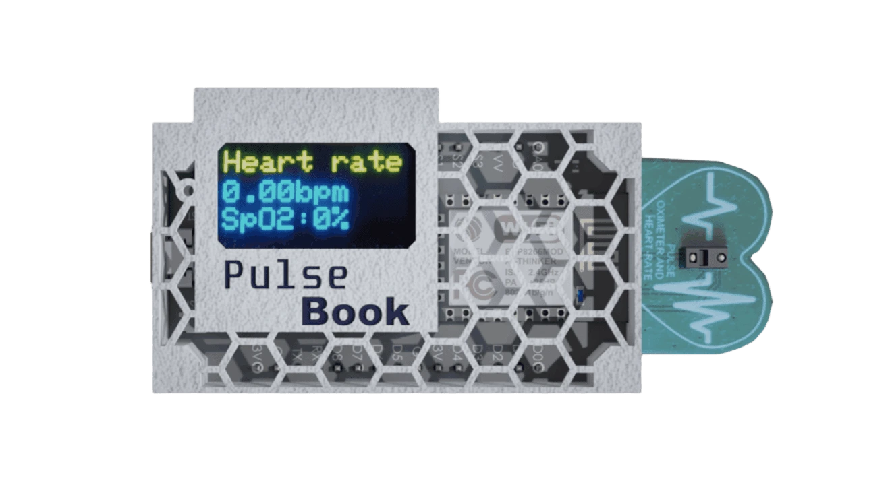

<a href="#" onclick="return false;"></a><br><br>
<a href="#" onclick="return false;"></a><br>
<a href="#" onclick="return false;"></a>
<a href="#" onclick="return false;"></a>
<a href="#" onclick="return false;"></a><br>
<a href="#" onclick="return false;"></a>
<a href="#" onclick="return false;"></a>


> [!WARNING]
> ### Repository Deprecated
> This repository is no longer actively maintained or supported. 
<br>Feel free to use or fork the code, but no further updates or issue responses should be expected.
<br>No active website.
  
## Table of contents
* [General info](#general-info)
* [Installation](#installation)

## General info
### Description
Pulsebook is a project that aims to improve and extend the functionality of the heart rate monitor. The site receives data packets that are processed and displayed on the logged-in user's dashboard. The database stores data related to the pulse, saturation and user data. It is a convenient solution for people who want to view their measurement history on a regular basis. There are also additional options that will allow us to check the condition and correct body weight, for example: <code class="language-plaintext highlighter-rouge">BMI counter</code>.
<br>

<a href="#" onclick="return false;"></a>

It is this project that uses the heart rate monitor.

## Installation
### Required software and frameworks:
1. Code Editor (VS Code recommended)
2. Python 3.10
3. Bootstrap 5.1
4. Flask 2.0.3

### Create environment:
Open terminal: <kbd>Ctrl</kbd>+<kbd>Shift</kbd>+<kbd>`</kbd> and paste:
```
cd ../PulseBook
python -m venv venv
venv\Scripts\activate
pip install -r requirements.txt
```
### Config debugger

Press <kbd>Ctrl</kbd>+<kbd>Shift</kbd>+<kbd>P</kbd> -> Debug:Select and start debugging -> Add configuration... -> Python -> Flask

### Generating the database (optional)
```
cd ../PulseBook
python db_generator.py 
```
### Device emulation (optional)
```
cd ../PulseBook
python device_emu.py
```
<br>

> [!NOTE]
> If you want to take full advantage of the application you need to add external services: PostrgreSQL and CDN Provider. Secret keys should be placed in the PulseBook/tests/.env file or in config vars if you > are using a VPS.

<p align="right">(<a href="#top">back to top</a>)</p>
